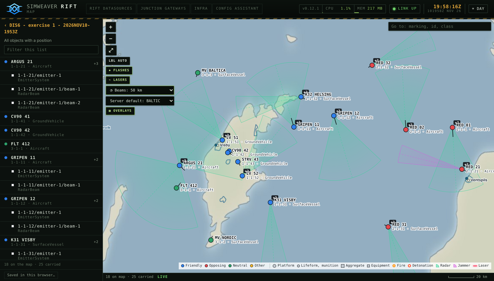
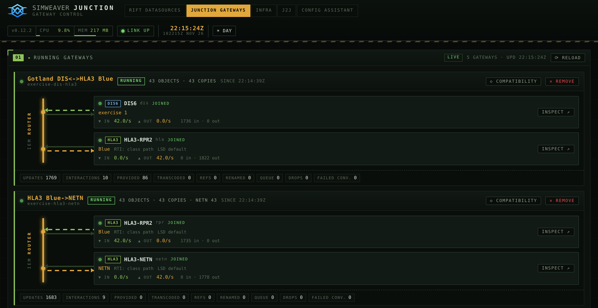
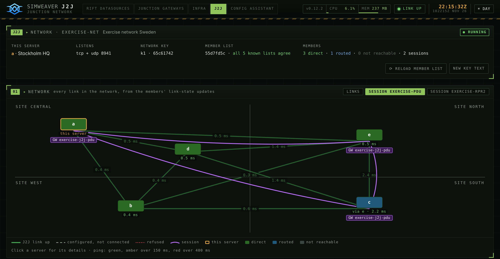

# SimWeaver Junction

SimWeaver Junction is a server for distributed simulation with HLA and DIS. It contains:

- **Rift**, for watching the data exchange in federations and networks.
- **Junction gateways**, which bridge them.
- **A web UI** in the browser, so clients install nothing.

It is written in Java 11 with no third-party libraries. The only external piece is the HLA RTI
of your choice, and only for the HLA parts.

Version 0.14.1 · BSD 3-Clause License · © 2026 Simweaver AB



*The Rift map: a DIS exercise around Gotland, with the radar and jammer beams of the emitters.*

<p>
  
  
</p>

*Left: Junction gateways bridging the same exercise from DIS 6 into an HLA RPR federation, and from
there into NETN with UniqueId and Callsign added. Right: the J2J network of five servers, with a
DIS session shared by three of them (one of them reached through another).*

---

## What it does

**Rift: look into a federation or a DIS network**

- **Datasources.** Join an HLA federation or listen to a DIS exercise, from a saved
  configuration.
- **Objects.** Browse the object instances by class, with fully decoded attribute values. RPR FOM
  v2 and v3, NETN and your own FOM modules are supported, or the FOM is taken from the
  federation itself. Entity types are named in words (*SWE CV9040A · Armored Fighting
  Vehicle*) from SISO-REF-010.
- **Interactions.** Follow them live, with rates per class. Link 16 messages are decoded down to
  the network header and the J-word framing.
- **Map view.** See the entities on a map:
  - dead reckoned, with radar and jammer beams, laser designators, fire and detonation flashes;
  - over a GeoTIFF background;
  - with shapefile overlays read straight from their `.zip` packages: coastlines, borders,
    towns, airports, roads.
- **Comms view** (0.12.0). The HLA Comms channels (voice, radio, chat) and the RPR / DIS radio
  frequencies a datasource hears, with the transmitters and the platforms carrying them, two
  minutes of activity per channel, the chat transcripts, and **listening** to voice and radio
  channels in the browser.
- **REST API and SSE events** for everything the UI shows.

**Junction: bridge federations and networks**

- **Endpoints:**
  - HLA Evolved (IEEE 1516-2010)
  - HLA 4 (IEEE 1516-2025), also over the Federate Protocol
  - DIS 6 and DIS 7
  - C-DIS (Compressed DIS, SISO-STD-023-2024), full and partial updates
  - HLA Comms (the FOM is taken from the running federation while tapping into communications federations, see below)
  - Apache Kafka topics (0.13.0), with Junction's own Kafka client
- **RPR FOM v2.0 ⇄ v3.0**, converted by a rules table plus code for the structural
  differences: IFF modes, articulated parts and jamming.
- **DIS ⇄ RPR**, including:
  - entities, fire, detonation, collision;
  - radios and audio;
  - emitters, radar and jammer beams;
  - designators, IFF;
  - Link 16 Signal PDUs.
- **DIS 7 ⇄ C-DIS PDU relay**: all 22 C-DIS PDU types passed PDU by PDU, not through the RPR model.
- **Apache Kafka** (0.13.0): a gateway writes DIS PDUs, or HLA objects and interactions as JSON
  with the FOM's names, to a Kafka topic, and passes on what others write there. Consumer groups
  with committed offsets, gzip / snappy / lz4, SASL PLAIN and SCRAM, TLS. No Kafka library needed.
- **Class filters**, instance renaming (for all objects, or chosen by class and name pattern)
  and object reference rewriting, also inside records, arrays and variant records.
- **Several DIS send addresses** (0.14.0): unicast, broadcast and multicast mixed, each PDU to all.
- **Value rules**, e.g. one entity type replaced by another in passing.
- **NETN properties** (0.12.0): RPR and DIS objects going into a NETN federation get a NETN
  `UniqueId` and a `Callsign` from their Marking.
- **HLA Comms** channel mapping, and a radio bridge to RPR/DIS. No HLA Comms FOM is delivered:
  HLA Comms endpoints take it from the running federation, or from your own copy of the files.
- **FOM from the federation.** An HLA endpoint set to `dynamic` joins and reads the
  federation's FDD from the MOM, so it bridges whatever FOM the federation runs, without copies
  of the modules.
- **One process, several RTIs.** Each endpoint can load its own RTI library, so one gateway can
  bridge two vendors or versions.
- **Groups of gateways**, started together with shared variables.
- **The Config Assistant** page writes gateway configurations for you.

**J2J: a network of SimWeaver servers** (0.10.0, off unless configured)

- **Encrypted links** between the servers of an exercise (AES-256-GCM, a shared network key,
  fresh keys per link), over TCP and UDP on one port, or TLS on 443 as the last resort, also
  through a web proxy. A server behind NAT only dials out.
- **Routing** through the servers that reach each other, around broken links; reliable traffic
  is resent on the new path.
- **Sessions:** Junction gateways on different servers share DIS PDUs as they are, or the objects
  and interactions of an HLA object model (RPR, NETN, HLA Comms …), so federations and DIS networks at
  several sites become one exercise.
- **The J2J page:** the members, how each is reached, ping, a diagram of the network and its
  sessions, and the J2J events. The protocol is documented for other implementations.

**API tokens** (0.11.0, off unless configured)

- With `api.auth.enabled=true`, every REST call, live stream and map tile needs an **API token**
  (`Authorization: Bearer swt_…`), and the web UI signs in once on a login page with it.
- Tokens are made on the server (`run.sh --new-token=<name>`); the server keeps only their
  hashes, and deleting a token's lines from its file revokes it at once.

**MCP: tools for AI assistants** (0.14.0, off unless configured)

- With `mcp.enabled=true`, AI assistants and agents can ask the server over the **Model Context
  Protocol**: which objects there are and where, range, bearing, closing speed and closest
  approach between them, recent fire and detonations, gateway and J2J health, the exercises and
  federations heard. Read only, behind the API tokens, every call logged.
- Both protocol eras (2026-07-28 and the 2025 handshake), tested with the official MCP SDK client.

**Infra: what the server has contact with** (0.9.20)

- Every **DIS 6, DIS 7 and C-DIS exercise** the datasources' and gateways' sockets hear, with each
  sender's address, its site and application numbers, PDU types and activity.
- Every **HLA 1516-2010 and 1516-2025 federation** they have joined, with the federates from the
  MOM: host, type, state, what each sends and receives, and on request its publications and
  subscriptions.
- A **breakout tab** keeps watching the exercises and federations you pick.

---

## Requirements

| | |
|---|---|
| **Java** | 11 or later (the code is compiled for Java 11) |
| **HLA RTI** | Only for HLA datasources and endpoints: any RTI with the IEEE 1516-2010 or 1516-2025 Java API. DIS works without one. |
| **Browser** | A current Microsoft Edge or Google Chrome |
| **OS** | Windows, Linux or macOS. Examples for Docker or Podman, a systemd service and a Windows service (WinSW) are in `simwrift/rtdir/etc`. |

---

## Source layout

```
simwcommon/        shared library: HLA codec and RTI sessions, DIS <-> RPR, FOM model (IEM),
                   settings, REST/SSE server, JSON, logging, geo, the J2J network, a Kafka client
simwjunction/      the Junction gateways: endpoints, routers, RPR conversion, HLA Comms bridge, REST API
simwrift/          the Rift server, datasources, decoders, map, and the main class
  rtdir/           the runtime folder: what gets installed
    etc/           server settings, datasource and gateway configurations, FOMs, mappings;
                   etc/junctions.dist holds every sample gateway configuration, untouched
    webroot/       the web UI (plain HTML, CSS and JavaScript)
    doc/           user documentation
    maps/          background rasters, shapefile overlays, tile cache
    lib/           the application jar goes here
build.sh           command-line build
```

Each module has `src/`. The self tests are in `test/` next to it.

---

## Build

**From the command line** (Linux, macOS, or Git Bash on Windows):

```sh
./build.sh
```

`build.sh` compiles the three modules and the tests, then packs
`out/artifacts/simweaverrift/simweaverrift.jar`. It compiles against the HLA API jars, and only
the API classes are needed. Point it at your RTI's jars with `HLA_API_CP`. Use `:` between
files on Linux and macOS, `;` in Git Bash on Windows (`/opt/anrti/...` stands for your RTI):

```sh
HLA_API_CP=/opt/anrti/lib/hlaimpl.jar ./build.sh
```

The RTI is loaded by reflection at run time, so the jar itself contains no RTI.

---

## Install and run a release build

1. Download the release build zip-file and unzip to a writable installation folder of own choice.
2. Set `RTI_JAR` in `run.bat` (Windows), `run.sh` (Linux) or `run.command` (macOS) to your RTI's Java library. Leave it
   empty for DIS only.
3. Configure your data sources and gateways as described by documents in `doc` folder of the installation.
3. Start it with `run.bat`, `run.sh` or `run.command`, and open `https://<server>:8843` in a browser.

The installation guide (`doc/simweaver-rift-install-and-config.md`) covers more: services,
Docker, maps and every setting.

---

## Install and run the checked out project

1. Copy `simwrift/rtdir` to the installation folder.
2. Put `simweaverrift.jar` in its `lib/`.
3. Create a key store for HTTPS. The command is in `keystore-gen-line.txt`; use your own
   password, and set it in `etc/server.root.settings`.
4. Set `RTI_JAR` in `run.bat` (Windows), `run.sh` (Linux) or `run.command` (macOS) to your RTI's Java library. Leave it
   empty for DIS only.
5. Download a release build and fetch the raster map directories for it, and place under `maps/raster`
6. Start it with `run.bat`, `run.sh` or `run.command`, and open `https://<server>:8843` in a browser.

The installation guide (`doc/simweaver-rift-install-and-config.md`) covers more: services,
Docker, maps and every setting.

---


## Documentation

All in `simwrift/rtdir/doc/`:

| File | Contents |
|---|---|
| `simweaver-rift-install-and-config.md` | Installation, server settings, datasources, maps and overlays, logging, the J2J network, API tokens |
| `web-ui.md` | The web UI: datasources, objects, interactions, the map view, Infra, J2J |
| `rest-api.md` | Rift's REST API and SSE events, and how to authenticate |
| `junction.md` | Junction: gateways, endpoints, routers, value rules, HLA Comms, groups, RPR v2 ⇄ v3, DIS, J2J sessions, Kafka topics |
| `junction-rest-api.md` | Junction's REST API |
| `j2j-rest-api.md` | The REST API of the J2J page |
| `j2j-wire-protocol.md` | The J2J protocol between the servers, with test vectors |

---

## License and contributing

SimWeaver Junction is open source software under the BSD 3-Clause License. See
[`LICENSE`](LICENSE). The name covers the whole source set: `simwcommon`, `simwjunction` and
`simwrift`.

Contributions are welcome. Read [`CONTRIBUTING.md`](CONTRIBUTING.md) first. Contributors accept
the [Contributor License Agreement](CLA.md) before a contribution can be merged.

The HLA RTI is not part of SimWeaver Junction. It is licensed by its vendor and installed
separately.

`simwrift/rtdir/etc/enumerations/SISO-REF-010.xml` is SISO's *Enumerations for Simulation
Interoperability*, © SISO Inc., distributed unchanged under the licence in the file. Reprinted with
permission from SISO Inc. It is not covered by the BSD 3-Clause License; see
`etc/enumerations/NOTICE.txt`.