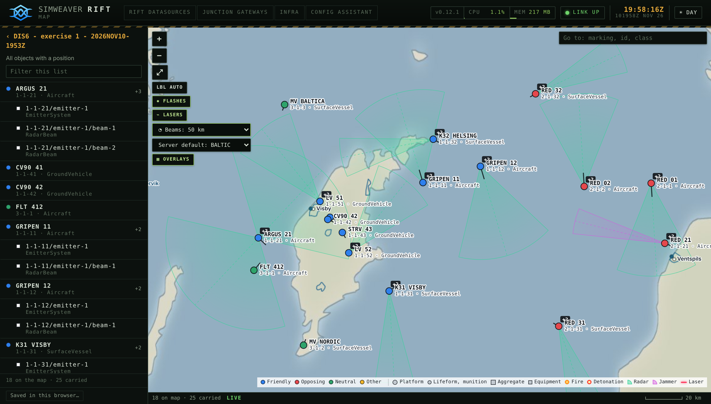
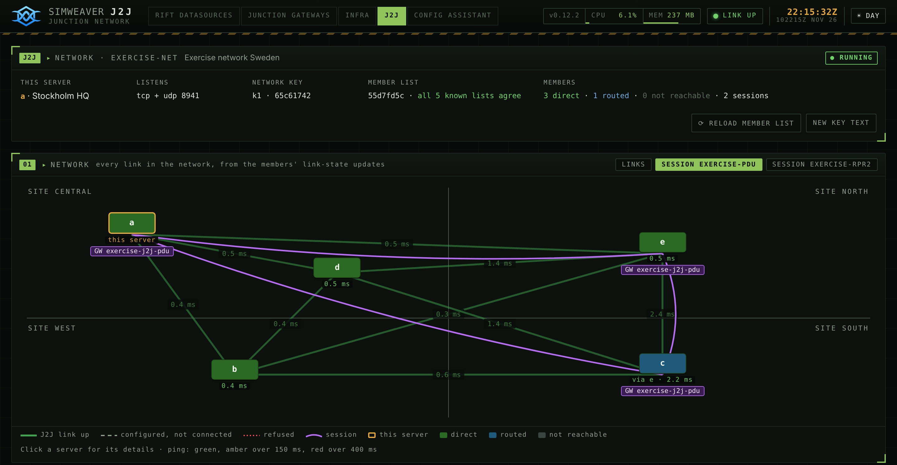
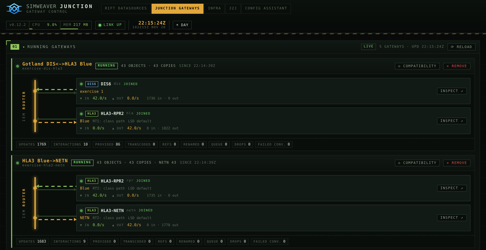

# SimWeaver Rift — Web UI

The Web UI is the browser front end of the SimWeaver server: Rift's datasources, Junction's
gateways, the Infra page and the Config assistant. From a browser you can:

- start a datasource (join an HLA federation or listen to a DIS network) from one of the
  server's configurations, and stop it again;
- browse the object instances it discovers, by class, with decoded attribute values, and see
  them on a map;
- follow the interactions live, with rates per class;
- see the HLA Comms and radio channels a datasource hears, read the chat and listen to the voice
  and radio channels (**Comms**, 0.12.0);
- see every exercise and federation the server has contact with (**Infra**);
- see the J2J network of SimWeaver servers this server belongs to (**J2J**, when configured);
- start and watch Junction gateways, and write configuration files with the Config assistant.

The server serves the Web UI itself. Clients need only a current Microsoft Edge or Google Chrome
and access to the server's HTTPS port: nothing to install, and no internet access is needed.
Installing and configuring the server: [simweaver-rift-install-and-config.md](simweaver-rift-install-and-config.md).

---

## Open the Web UI

Browse to the server's address and port (`webserver.port`, default 8843):

```
https://<server>:<port>/          for example  https://localhost:8843/
```

The server is ready when its console shows *We are good to go!*. It uses HTTPS only; with a
self-signed certificate the browser warns on the first visit. Accept the warning, or have the
certificate installed as trusted on the client machines.

**Signing in (0.11.0).** When the server has API authentication on (installation guide, 2.9), the
pages open the **login page** first. Paste the API token you were given (it starts with `swt_`;
*Show the token* lets you check it) and press **Sign in**: you come back to the page you asked for.
The browser stays signed in for 12 hours (the server's `api.auth.sessionhours`), until **Sign out**,
until the token is revoked, or until the server restarts; then the login page comes again. Without
API authentication there is no login page.

> Links to a datasource page (`datasource.html?id=…`) can be bookmarked and shared. They work
> for as long as that datasource is running. Links to an Infra breakout tab keep working across
> restarts.

---

## Using the Web UI

### Top bar (all pages)

- **SimWeaver logo** and the page's name; the buttons next to it switch between **Rift datasources**,
  **Junction gateways**, **Infra**, **J2J** (only while this server is configured for a J2J network;
  red when J2J did not start) and the **Config assistant**.
- **Zulu clock:** the time in UTC, with the date-time group.
- **LINK lamp:** *LINK UP* while the server answers, *LINK LOST* when it cannot be reached.
  The page keeps retrying by itself.
- **Server readout:** the server version, the server process's CPU (in percent of the whole
  machine) and its memory use. Hover over it for details such as uptime, threads and Java
  version, and, when the server sends its log to a syslog server, how many messages were sent,
  are waiting or were dropped. It turns amber from 70 % and red from 90 %. It is hidden on
  narrow screens.
- **Day / Night:** switches between the dark and the light theme. The browser remembers the
  choice.
- **Sign out** (0.11.0, only with API authentication on): ends this browser's sign-in and opens the
  login page. Its tooltip names the token you signed in with and until when.

> **After updating the web files** on the server, reload the page once with **Ctrl+F5**, so that
> the browser does not keep using its cached scripts.

### Saved in this browser (page footer)

The pages remember a few choices in your browser: the theme, the background map you picked,
where each map was looking, the map layers, list or map, whether the gateway configurations are
shown, the rows marked on the Infra page, and everything filled in on the Config assistant. **Saved in this browser…** at the bottom
of every page (in the map tab: under the entity list) lists them with **Clear** for each, and
**Clear all**. This affects only your browser, never the server or other users.

Datasource configurations, gateways and maps are not stored in the browser: they always come
from the server. Map tiles the browser keeps are replaced by themselves when the server's map
file changes.

### Overview page

**01 · Available datasource configurations.** One card per configuration file.

1. Press **▶ Create datasource** on a card.
2. HLA: check the **LSD** (*RTI configuration* for HLA 4). It is the configuration's default.
   When `datasource.hla.lsd` lists several, they are offered as buttons; any other value can be
   typed, and empty is the RTI's own default. **↺ Default** puts the default back. Picking one
   rescans the federations on it.
3. Check the **federation** name. It is filled in from the configuration, and you may change
   it.
   - **Discovered federations** lists the federations the server finds for the
     configuration's RTI. Click one to use it. **⟳ Rescan** searches again.
   - **↺ Config value** puts the configured name back.
4. Press **▶ Create datasource** in the dialog. The server connects to the RTI and joins the federation, which may take
   a few seconds.
   - **On success**, the dialog closes and the new datasource is highlighted in the list.
   - **If joining fails**, the dialog stays open and shows the server's message, for example
     `ConnectionFailed: …` when the RTI cannot be reached. Correct the federation name and
     try again, or cancel.

**Configurations from Junction gateway endpoints.** Every endpoint of every gateway file in
`etc/junctions` is also a datasource configuration (chip *JUNCTION*), so you can look at what a
gateway's federation or network sees. They are made by the server from those files, not saved in
the browser, and are listed in a group of their own below your configurations, folded away
until you press **▸ Show** (the browser remembers it). They disappear when their gateway file is
removed. The server setting `junction.datasourceconfigs=false` leaves them out of the list; the
Junction page's **Inspect** still works.

**02 · Running datasources.** One row per running datasource.

- Click a row to open its datasource page.
- **✕ Remove** resigns from the federation, disconnects and removes the datasource. You are
  always asked to confirm first.

### Datasource page

The header shows the datasource name, its state (for example `JOINED`) and the federation.
Click **Config** to see the configuration it runs with. Below the header are three panels:

**Classes** (left)
- The object classes that have instances, with counts summed up the tree.
- Click a class to show only its objects, including subclasses. You can select several
  classes; **✕ All** clears the selection.
- Type in the filter box to find a class by name.

**Object instances** (middle)
- **Search** looks in the label, the instance name and the shown attributes, and (0.11.1) in
  the entity type's name and country: `cv90`, `sweden` or `swe` find the objects of that type
  or country.
- **Sort** by label, class, last update or newest.
- Tick **+ related** to add the objects that refer to the shown ones. For example, it adds
  the radios hosted on the selected aircraft.
- The list loads 200 objects at a time, and more as you scroll.
- Each row shows the label (the RPR `Marking`, when there is one), the class, the key
  attributes, and how long ago the object was last updated.
- New objects are not pushed into the list while you read it. A **▲ N new objects** banner
  appears instead; click it to reload the list.
- **Click a row** to open the object:
  - **All attributes**, decoded and updated live. Structured values open as trees.
    - Derived values (latitude, longitude, heading, speeds) are shown with the RPR `Spatial`
      attribute.
    - `DRSpatial` is the dead-reckoned position "now", updated about once per second.
    - **Entity types in words** (0.11.1): below the numbers of an entity type (`EntityType`,
      `AlternateEntityType`, a munition type …) its name from SISO-REF-010, with the country's
      code before it, e.g. `SWE  CV9040A · Armored Fighting Vehicle`. When the file does not
      list the type down to its last number, the nearest broader name is shown, marked ≈
      (*≈ Combat Vehicle 90 (CV90)*). Hover over it for the whole chain, from the kind to the
      variant. The list rows show the short form. Without the file (installation guide, 2.10)
      only the numbers are shown.
  - **HEX** shows the raw bytes of an attribute.
  - **References** lists the objects this one points to, and **Referenced by** the objects
    that point to it.
  - Click any object chip to jump to that object. An object that is not in the current list
    is pinned above it.
  - **⎘ Interactions** shows only the interactions that involve this object.

**Interactions** (right)
- **Rate ticker:** one row per interaction class, with the current rate and a 60-second
  graph. Click a row to show only that class.
- **Live tape:** the newest interactions first, with UTC time to the millisecond and the time
  since the previous row.
  - Repeated interactions of the same class from the same federate are folded into one row
    (`×23`).
  - Click a row to see all its parameters, decoded.
  - Link 16 messages are labelled with their J-message, for example `J3.2 Air Track`, from HLA
    and from DIS Signal PDUs. A row shows the source track number and the NPG, and the details
    show each message's name and category, the time slot and the transmit time. The message
    contents (positions, tracks) are defined in the restricted MIL-STD-6016 and are shown as hex.
- **❚❚ Pause**, or scrolling down, holds the tape. A banner counts what arrives meanwhile;
  click it to go back to live.
- At very high rates the server sends at most 50 interactions per second to the page. The
  rates stay exact, and the tape shows *sampling*.

The server keeps the latest 10 000 interactions per datasource; older ones leave the tape's
history.

**Map** (in the object panel: **☰ List | ◉ Map**, or **⧉ Map tab** for a page of its own)



- The objects of the current filter (class tree, search, *+ related*) that have a position, on a
  map: symbols coloured by force (friendly blue, opposing red, neutral green, other yellow),
  sized by zoom, with a speed line in the heading. The shape tells what kind of object it is
  (0.9.22; the legend shows them):

  | Symbol | Objects (the class and its subclasses) |
  |---|---|
  | Circle | Platforms, and every other kind of entity |
  | Smaller circle (80 %) | `Lifeform` (people, animals) and `Munition` |
  | Square, as wide as the circle | `AggregateEntity` (units, formations) |
  | Smaller square (80 %) | Attached equipment: radios, emitter systems, designators and other `EmbeddedSystem`s, beams, and radio or sensor entities attached to a platform. White, as they have no force of their own |

  The shape comes from the class name, so it works for DIS (by entity kind) and for RPR v2,
  RPR v3 and NETN federations alike. The labels show the marking, entity id and
  class; where they would overlap, only some are shown (**LBL** switches automatic / all / off).
- Positions are the dead-reckoned `Spatial`, updated once a second and moved on in between.
  Objects without a position are counted in the status line, not drawn.
- **Carried objects** (radios, mounted or attached parts) are not drawn on their own: their host
  has a **+N** badge. Click it to fan them out, or use *Carries N* in the host's card. Fanned out,
  each has its own shape: equipment a small white square, a mounted lifeform a small circle in
  its force's colour, and so on.
- **Zoom** with the wheel, a pinch, double-click, **+ / −** or the keys `+` `-`; drag or use the arrow
  keys to pan. **⤢** shows all entities.
- **Click an entity** for its card: position, altitude, heading, speed, what it carries.
  **⌖ Center**, **◎ Follow** (keeps it in the middle until you move the map; `F` key, `Esc` stops),
  **☰ Details** (back to the list, with the object opened).
- **Go to:** type a marking, entity id or class in the box at the top right.
- In the list, an opened object has **⌖ On map** (a radio shows its host).
- The **Map tab** has the same map with a list of the entities on it (click: go to; double-click:
  follow).
- **Background map.** The server decides the default (`map.file`). When it has more than one map,
  the chooser under the zoom buttons switches. *Server default: …* follows the server, also when
  its setting changes; any other pick is remembered in this browser for every datasource, and the
  Map tab link carries it (`&map=<id>`).
- **▦ OVERLAYS** (when the server has shapefile overlays, see *2.5 Map overlays* in the
  installation guide): coastlines, borders, roads, towns, airports and the like over the
  background. The menu turns each one on or off (remembered in this browser), with the number of
  shapes and the zoom its labels start at. Labels avoid each other: where two would overlap, the
  higher ranked one (e.g. the larger town) is shown, and more appear as you zoom in.
- **✸ FLASHES** (on by default): a short flash where a weapon fires (small, yellow-orange) and
  where a detonation happens (larger, with a red ring), then nothing. It covers `WeaponFire`,
  `MunitionDetonation` (RPR v2), `Fire.*`, `Detonation.*` (RPR v3, also `Explosion` and
  `DirectedEnergyFire`) and their subclasses, from HLA and from DIS Fire and Detonation PDUs. The
  place is the interaction's firing or detonation location, else the firing (or target) entity.
  Flashes are at most a second late (the map asks once a second); events older than 4 s are not
  shown.
- **⌁ LASERS** (on by default): laser designators as a red line from the designating entity to
  the laser spot, with a pulsing ring on the spot. When the designator names a designated object
  and the spot is on it (within 50 m), the ring goes around that object and moves with it;
  otherwise the spot is the designator's spot location. A designator with output power 0 is not
  lasing and is not drawn. It covers `EmbeddedSystem.Designator` (RPR v2 and v3) and its
  subclasses; in a DIS datasource from Designator PDUs. The designator is listed under its host
  (*Carries*); its card shows the designated object, the spot, the range, code, power and
  wavelength, and the designated object's card says *Designated by*.
- **◔ Beams** (off by default): radar beams (green) and jammer beams (magenta) as sectors from
  their host: the host's heading plus the beam's azimuth centre, the azimuth sweep on either side.
  The RPR FOM has no range for a beam, so you choose the length (25 to 400 km, or a fixed length
  on the screen). The selected host's beams are drawn stronger. Beams come from
  `EmitterBeam.RadarBeam` / `JammerBeam` objects (and subclasses), found through their emitter
  system's host; in a DIS datasource from Electromagnetic Emission PDUs. A beam is also listed
  under its host (*Carries*), and its card shows the emitter, function, azimuth, elevation,
  frequency and ERP. Pitch and roll of the host are ignored.
- The layer choices are remembered in this browser for every datasource.
- The maps and their settings: see *2.4 Maps* in the installation guide. The server
  setting `map.enabled=false` removes the map.

### Comms page (0.12.0)

**☎ Comms** in the datasource page's header opens `comms.html?id=<datasource>` in its own tab:
the communication channels that datasource hears, live.

- **HLA Comms**: the voice, radio and chat channels of the HLA Comms federation and the lobby,
  with the HLA Comms clients heard in each.
- **Radio · RPR / DIS**: one channel per frequency of the radio transmitter objects. Each lists
  its transmitters, with their state (**TX** transmitting, **ON**, **OFF**) and the platform that
  hosts them (*1-2-3/radio-1 TX on VIPER 11 Aircraft*). Click a transmitter or a platform to see it
  on the datasource page. A frequency that only carries data (raw binary, Link 16, database index,
  application specific signals) shows the kinds and counts, and its activity, nothing to listen to.
- **Activity**: every channel has a graph of the last two minutes (messages or audio frames per
  second), the last second's rate and how long ago it was active. The lamps light while someone
  speaks. **Active only** hides the channels quiet for two minutes; the filter box searches names,
  frequencies, transmitters and platforms.
- **Chat** (panel 02): the transcript of an HLA Comms chat channel or the lobby, live, with each sender in
  a colour of its own. Pick the channel in the tabs, or with **Transcript** on its row. The server
  keeps the last 500 messages per channel. The panel is hidden while there are no chat channels.
- **Listen**: tick **Listen** on audio channels. The browser plays them mixed, each with its own
  volume and level meter; **Master** sets the volume of all, **■ Stop all** stops listening. The
  status next to *Listen* says LIVE, CONNECTING or what went wrong. The sound is about 0.2 s behind.
  - Played: HLA Comms PCM16 (the datasource's `datasource.comms.samplerate` and `pcmbyteorder`, by
    default 16 kHz little endian) and RPR / DIS 16-bit linear PCM (either byte order), 8-bit linear
    PCM and mu-law. Other encodings (CVSD, GSM, …) show their name in red: heard, not played.
  - **Opus** (the other HLA Comms codec, 0.12.1) is decoded by the browser itself (WebCodecs): a current
    Edge or Chrome, Firefox 130 or later. In a browser without it the Opus badge is red and the
    tick is off, with the reason in its tooltip. A decoding problem shows next to *Listen*.
  - Browsers start sound only after a click on the page, which the tick is.
  - The audio comes from the server as one stream per tab, only for the ticked channels, about
    128–256 kbit/s per channel while it carries sound.

### Infra page

The top bar's **Infra** opens `infra.html`. It lists what the server has contact with, from
everything that is running: Rift's datasources and Junction's gateways. There is nothing to
configure.

- **Five lists:** DIS 6, DIS 7 and C-DIS exercises, HLA 1516-2010 and HLA 1516-2025 federations.
  A DIS socket reports every exercise it hears, also the ones its datasource or endpoint filters
  out, so a DIS 7 datasource on exercise 1 also shows a DIS 6 exercise on its port.
- **One row per contact.** The same exercise heard by two sockets is two rows. Each row says who
  has the contact and links to that datasource's page or to the Junction page. The lamp is green
  while traffic comes in, amber after a few quiet seconds, grey after a minute.
- **Click a row** for its live detail:
  - *Exercise:* the PDU types, and each sender with its address and port (*THIS COMPUTER* when it
    is the server itself), the site and application numbers in its PDUs, its entities, PDU types,
    PDUs per second, traffic and the last minute. A Junction endpoint does not list its own PDUs.
  - *Federation:* the RTI, the time implementation and the federates from the MOM: name, type,
    host, state and time, what each sends and receives per second, and what this datasource or
    gateway receives from it. **⟳ Ask the MOM now** gets fresh values. Click a federate for all its
    MOM values, and **Ask the MOM for publications & subscriptions** to see what it publishes and
    subscribes (the RTI answers with reports; nothing in the federation changes).
- **Breakout tab.** Tick the rows to keep an eye on and press **⧉ Open breakout tab** at the bottom.
  The new tab shows those items, live, while you work elsewhere. It finds them again after a
  restart of the server or of their datasource or gateway; until then it says *Not connected
  now*. **✕** stops watching one. The marks are kept in this browser.
- The MOM is asked every few seconds while a federation is open, and about once a minute
  otherwise (installation guide, 2.6).

### J2J page

The top bar's **J2J** opens `j2j.html`: the J2J network of SimWeaver servers this server
belongs to (installation guide, 2.8). Everything on it updates live.



- **Network:** this server's id, the ports it listens on, the network key's id and fingerprint
  (compare fingerprints with the other sites, never the key), whether the members' lists agree,
  and how many members are reached directly, through others, or not. **⟳ Reload member list**
  reads `etc/j2j/network.settings` and `network.key` again (a list with problems is not applied
  while J2J runs). **New key text** makes a random key to copy to every member; it is not installed.
  When J2J did not start, a red box says why.
- **01 Network:** a diagram of the servers, grouped by site, and every link the members report:
  green when up (with its ping), grey dashed while being dialled, red dotted when refused. This
  server has an amber frame; members reached through others are blue. Click a server for its row.
- **02 Members:** one row per member: its state, where it is reached, how (`TCP`, `TCP + UDP`,
  `TLS 443`, or *routed*; the lock means encrypted), the ping with its last minute, and the
  gateways using it. Ping colours: green, amber over 150 ms, red over 400 ms. **Click a row** for
  the addresses tried, the channels, the route, the traffic per class, the member's own status
  (version, uptime, CPU, memory, gateways), its clock offset, and **⌁ Ping**, which measures the
  path hop by hop.
- **03 Sessions:** gateways on different servers sharing DIS PDUs or HLA objects through a session
  (Junction's `j2j` endpoint): each session with its model and members, *lost* when a member's server cannot be
  reached, *other model* when it uses another DIS version or exercise. **01 Network** can show a
  session instead of the links: its gateways on the servers, joined by purple lines.
- **04 Events:** the J2J log events (links up and down, routes, refused connections, member list
  warnings), newest first; **Warnings** shows only the problems.

---

## Troubleshooting

| What you see | Cause and what to do |
|---|---|
| The browser warns that the connection is not private | The server uses a self-signed certificate. Accept it, or install the certificate as trusted |
| The page looks broken, or something is missing after an update | The browser uses old cached files. Reload with **Ctrl+F5** |
| **LINK LOST** | The server cannot be reached: it is stopped, or the network is down. The page reconnects by itself when the server is back |
| No configurations are listed | `etc/datasources/` is missing or empty, or the files lack `datasource.name` / `datasource.standard`, or the standard is none of `ieee1516-2010`, `ieee1516-2025`, `dis6`, `dis7`, `cdis` (see the installation guide, 2.2) |
| *Federation discovery not available* in the create dialog | The server cannot list federations for this configuration. Type the federation name yourself |
| Create fails with a message such as `ConnectionFailed: …` | The RTI or its LSD/CRC cannot be reached, or the federation cannot be joined. The message comes from the RTI |
| *Datasource not found* on the datasource page | The datasource was removed, or the server was restarted (running datasources are not kept over a restart). Create it again from the overview |
| An object shows *No attribute values received yet* | The federate that owns it has not sent any attribute updates yet |
| The server readout is missing from the top bar | The window is narrower than 640 px, or the server is older and has no `/api/serverinfo` |
| The Infra page lists nothing | Nothing is running: Infra shows only what the running datasources and gateways have contact with. Or the server has `infra.enabled=false` |
| The **J2J** button is missing | J2J is off: `etc/j2j/network.settings` lists no members (installation guide, 2.8) |
| A J2J member stays *refused* | It has another network key or network id, or this server is not in its member list. The event says which |
| A J2J member says *list differs* | Its `network.settings` is not the same as this server's. Give every member the same file and reload |
| The login page says *That token is not valid on this server* | The token was not copied whole, was revoked, has expired, or was made for another server. Ask for a new one |
| The login page says *Too many wrong tokens* | Ten wrong tokens came from this computer (or its network address) within a minute. Wait a minute |
| The login page comes back while you work | The sign-in ended: after 12 hours, the token was revoked, or the server restarted. Sign in again |
| An HLA federation on the Infra page says *no MOM* | The RTI did not let the federate subscribe its MOM classes. The federates are then known only by the traffic they send |

---

## Config assistant

The top bar's **Config assistant** opens `config-assistant.html`. It writes configuration files for
you; it does not change anything on the server.

- **Rift:** datasource configurations (`etc/datasources/`), the server settings
  (`etc/server.root.settings`, with a `keytool` command for the certificate) and the object list
  attributes (`etc/listprofiles.properties`).
- **Junction gateways:** gateways (`etc/junctions/*.junction.settings`), new endpoint and router kits,
  and groups with group variables.

In the Junction part, each endpoint and the router either **uses a kit** (a shared settings file in
`etc/junctions/endpoints/` or `routers/`, which many gateways can name) or has its settings **written in
the gateway file**. The page shows what a kit holds and which gateways already use it, and can save new
kits.

Every box on the left says what it is (**Gateway**, **Endpoint**, **Router**, **Datasource
configuration**, …) and, on its **Goes into** line, which file it ends up in. Each kind of file has its
own coloured label (*Gateway file*, *Endpoint kit*, *Router kit*, *Existing kit* = named, not written),
used on both sides. **show ↗** on a box jumps to its file; **Show in the form** on a file goes back to
its box.

Start from one of the suggested situations (for example *HLA ⇄ DIS 7*, *HLA ⇄ Kafka* or *DIS 7 network*) and adjust the
fields; each field explains itself. The **Files to create** panel shows each file's path and content
as you type, with **Copy**, **Path** and **Download** buttons, and lists what to fix or check: for
example a missing FOM, a gateway whose two endpoints would join the same federation, or a file that
would replace one the server already has (the page reads the server's lists to know). Put the files on
the server at the paths shown, then press **Reload** on the Rift or Junction page.

What you filled in is remembered in this browser; **Start over** clears a section.

---

## Junction gateways

The top bar's **Junction gateways** opens `junction.html`: gateways that bridge HLA federations,
DIS and C-DIS networks, HLA Comms federations, J2J sessions and Apache Kafka topics, configured in
`etc/junctions`. Their HLA and DIS endpoints also show up in the datasource list, marked *JUNCTION*.
See [junction.md](junction.md).

A Kafka endpoint (0.13.0) shows its topic, what its records are (*DIS PDUS* or *JSON OBJECTS*), the
consumer's lag and group, and the objects it wrote and read; hover over the line for the producer's
and consumer's counters and last errors. *PRODUCER FAILING* or *CONSUMER FAILING* means the brokers
cannot be reached or refuse it: the endpoint keeps trying. The Start dialog's **Discover** lists the
cluster's topics.



---

## For integrators

Everything the Web UI shows comes from the server's REST API and its live event stream, open to
other tools as well: [rest-api.md](rest-api.md) (Rift and Infra),
[junction-rest-api.md](junction-rest-api.md) (Junction) and [j2j-rest-api.md](j2j-rest-api.md) (J2J).

---

By SimWeaver - released under the BSD 3-Clause License.
